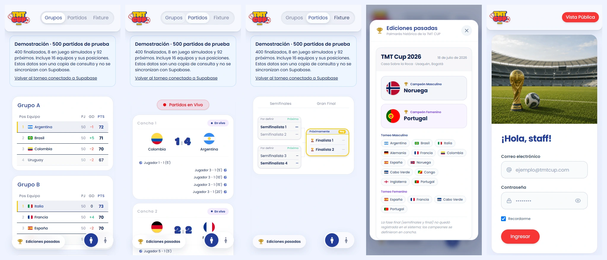
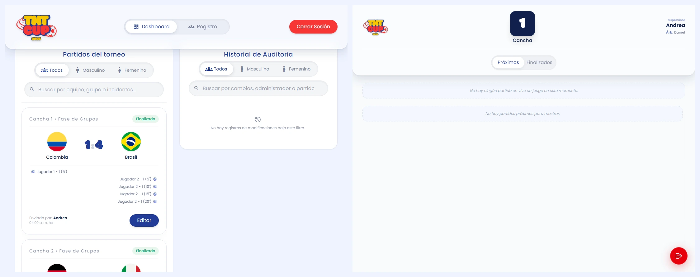

# TMT Cup

[Ver el torneo en vivo](https://tmtcup.vercel.app/)

La TMT Cup se organizaba en Excel. Cada resultado implicaba actualizar la hoja de cálculo para saber cómo quedaba el grupo y quién avanzaba. Con la plataforma, el marcador que se registra en la cancha alimenta la tabla de posiciones y, al terminar la fase de grupos, se definen los cruces de semifinales.

## El torneo desde la tribuna

El público puede seguir los marcadores en vivo, consultar los próximos partidos y recorrer el cuadro de eliminación. Las ediciones pasadas reúnen los equipos participantes y los campeones de cada categoría.

## De la cancha a la mesa de control

En cada cancha, el supervisor consulta su agenda, confirma la presencia de los equipos y registra goles, tarjetas e incidentes durante el partido. Desde la mesa de administración, la organización revisa las actas y puede corregir un resultado con un historial de los cambios.

