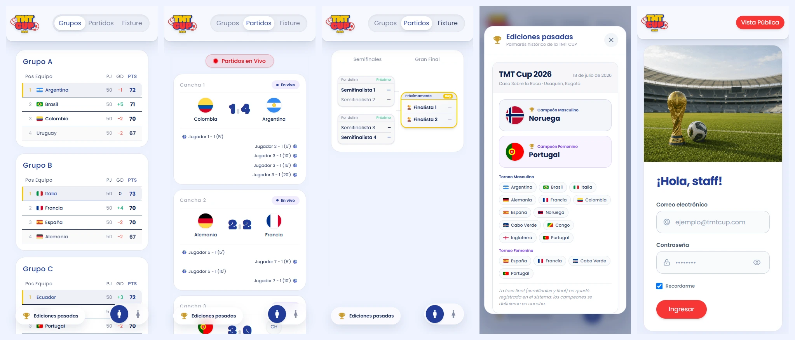
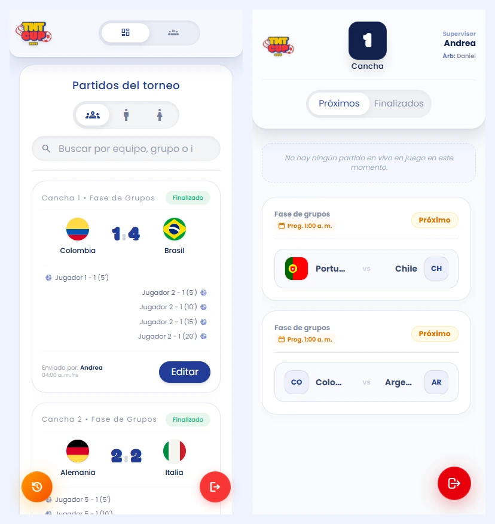

# tMtCup

[Ir al sitio](https://tmtcup.vercel.app/)

tMtCup nació para llevar a la cancha un torneo de fútbol que se organizaba en Excel. Antes, registrar un marcador y actualizar la clasificación eran dos tareas distintas. La plataforma conectó la agenda de cada cancha, el acta del partido y el cuadro de eliminación. Así, el resultado registrado por la organización también sirvió para calcular las posiciones y definir el siguiente cruce.

## El torneo desde la tribuna

Desde el teléfono, el público pudo consultar los horarios, seguir los marcadores y ver cómo cambiaba la clasificación en las categorías masculina y femenina. El historial de ediciones reúne los equipos participantes y los campeones de cada categoría.

## El trabajo detrás de cada partido

**Administración.** La mesa central reunió los partidos de todas las canchas en un panel. Desde allí, la organización pudo revisar y corregir actas, consultar el historial de cambios y gestionar el registro de equipos y jugadores.

**Supervisión.** Cada supervisor recibió la agenda de sus canchas. Desde el teléfono pudo confirmar la presencia de los equipos, dar inicio al encuentro y registrar goles, tarjetas e incidentes hasta el cierre del partido.

## Cómo se automatizó la clasificación

Al cerrar la fase de grupos de una categoría, la plataforma completa sus semifinales. En la masculina avanzan los líderes de tres grupos y el mejor segundo. En la femenina, el primer equipo se cruza con el cuarto y el segundo con el tercero. Para ordenar los equipos se consideran, en ese orden, los puntos, la diferencia de gol y los goles a favor. Una vez resueltas las dos semifinales, sus ganadores ocupan las plazas de la final. Estas reglas están en [lib/tournament.ts](lib/tournament.ts).

## Arquitectura y herramientas

| Capa | Implementación |
| --- | --- |
| Interfaz | Next.js 16 con App Router, React 19 y TypeScript. Tailwind CSS 4 da forma a las tablas, las tarjetas de partido y los paneles móviles. |
| API | Los [Route Handlers](app/api) gestionan sesiones del personal, eventos del partido, actas y consultas de clasificación. |
| Datos | PostgreSQL en Supabase guarda los equipos, jugadores, partidos y eventos. Las [migraciones SQL](supabase/migrations) documentan la evolución del esquema. |
| Actualización de la tribuna | La [vista pública](app/PublicLivePage.tsx) escucha cambios mediante Supabase Realtime y recurre a consultas periódicas si se interrumpe la suscripción. |
| Herramientas y despliegue | pnpm gestiona las dependencias, ESLint revisa el código y Vercel aloja el sitio. |
